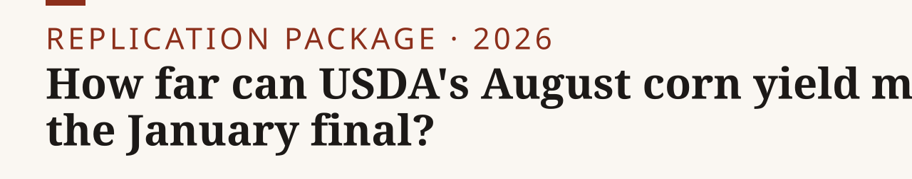

<p><picture><source media="(prefers-color-scheme: dark)" srcset="assets/banner-dark.svg"></picture></p>

**An 80% band built from USDA's own August misses covered 21 of 22 seasons, 2004–2025: too wide, with about 4 points of that excess expected from the estimator itself.**

[Memo (PDF)](out/memo.pdf) · [Write-up](out/writeup.md) · [Data](#data-availability) · [Site](https://nikkhosravipour.com)

[](LICENSE) [](LICENSE-docs) [](https://www.python.org/)

Each August, USDA prints its first survey-based US corn yield, and grains desks rebuild their balance sheets around it. This repository puts an 80% band around that print, built only from USDA's own past August misses against the January final. It then scores the band on every season from 2004 to 2025, using only what was public on each release morning, as archived (releases that survive only as corrected copies are flagged).

**Headline.** The 80% August band covered 21 of 22 seasons (95.5%; 90% Clopper-Pearson interval 80.2% to 99.8%). The pre-registered verdict is "too wide". The estimator is conservative by construction: at these sample sizes it is expected to cover 84.2% of seasons, so about 4 points of the excess are expected from the estimator itself. M3 and M1 are not distinguishable at August with 22 seasons: adding crop condition (Good/Excellent share) did not improve mean pinball loss (one-sided p = 0.888). None of the 33 exploratory tests falls below 0.05 after Holm adjustment.


The memo (`out/memo.pdf`) and the longer write-up (`out/writeup.md`) give the August 2025 answer, the stocks-to-use decision line, where the band breaks, and an exploratory port to Russian wheat. No traded edge is claimed.

## What makes the score honest

- **As-of store.** Every value carries the timestamp of the release that printed it, rebuilt from the raw USDA ESMIS archive (WASDE, Crop Production, Crop Progress). A guard refuses any value released after the forecast origin, and leakage tests run before every scored run.
- **Corrections as records.** Releases that survive only as corrected copies are flagged and used as archived. A sensitivity run drops the 2 affected origins; the August band still covers 21 of 22.
- **Rules first.** The acceptance rule, wording, sample and test family were frozen in `PREREG.md` (hash in `PREREG.sha256`) before any score existed. Later changes are logged with reasons in `PREREG-AMENDMENTS.md`. The evaluation ran once.
- **Every number traced.** `make memo` fails if any number in the memo, the write-up or this README does not appear in a generated output file or the pre-registration. The check is for presence, not meaning.

## Quick start

Requires Python `>=3.12` and [uv](https://docs.astral.sh/uv/). Raw files are not committed. `make store` downloads them from USDA ESMIS (keyless, cached, logged with SHA-256 in `data/manifest.csv`) and rebuilds the store.

```sh
make store          # fetch raw USDA files, rebuild the as-of store
make test-leakage   # look-ahead guards
make forecasts      # forecast layer (no truth column)
make memo           # tables, figure, memo PDF, write-up, number trace
```

`make evaluate` is the single pre-registered scoring run. It refuses to run if the pre-registration hash, a leakage test or a count check fails. Its outputs are already in `out/eval/`.

A clean rebuild is `make store forecasts quickstats replication memo` (or `make all`); `make evaluate` and `make russia` are one-shot scoring runs whose outputs ship in `out/`.

## Exhibit map

Every exhibit in the memo and write-up, the command that makes it and the file it writes.

| Exhibit | Command | Output |
|---|---|---|
| Figure 1: August band and January final, 2004–2025 | `make memo` | `out/memo/fig_aug_band.png` (`.svg`) |
| Coverage by horizon | `make memo` | `out/memo/coverage_table.md`, `out/memo/coverage_memo.md` |
| August 2025 answer | `make memo` | `out/memo/august_answer.md` |
| Stocks-to-use decision line | `make memo` | `out/memo/stocks_to_use_aug.md` |
| Stress years | `make memo` | `out/memo/stress_years.md` |
| Primary verdict, test family with Holm-adjusted p | `make evaluate` (one run, already done) | `out/eval/primary.txt`, `out/eval/family.csv` |
| Russian wheat port (exploratory) | `make russia` (one run, already done) | `out/russia/primary.txt`, `out/russia/coverage.csv` |
| Memo and write-up | `make memo` | `out/memo.pdf`, `out/memo.md`, `out/writeup.md` |

## Data availability

| Dataset | Source | Access | Included |
|---|---|---|---|
| WASDE | World Agricultural Outlook Board, via USDA ESMIS | Public, keyless | Raw: no (`make store` fetches it). Derived tables: `data/` |
| Crop Production | NASS, via USDA ESMIS | Public, keyless | Raw: no. Derived tables: `data/` |
| Crop Progress | NASS, via USDA ESMIS | Public, keyless | Raw: no. Derived tables: `data/` |
| Quick Stats bulk file | NASS, nass.usda.gov | Public, keyless | Raw: no (`make quickstats`) |

Data: USDA public releases (WASDE from the World Agricultural Outlook Board; Crop Production, Crop Progress and the Quick Stats bulk file from NASS), fetched from USDA ESMIS and nass.usda.gov. These are US government works. Credit: U.S. Department of Agriculture. The derived CSVs in `data/` are re-tabulations of those releases, each row keyed to the release that printed it; values are not altered. This project uses NASS data but is not endorsed or certified by NASS, and no USDA agency endorses its methods or results.

## Repository layout

| Path | Contents |
|---|---|
| `src/cfstore/` | store, as-of guard, models, evaluation, memo rendering, number trace |
| `data/` | release tables, selection logs, manifest (raw files under `data/raw/` are fetched, not committed) |
| `out/eval/` | scored results: coverage, test family with Holm-adjusted p, stress years, sensitivities; they record the hash of the scored `forecasts.csv`, which differs from the shipped file only in its build-stamp columns |
| `out/memo/` | memo tables, figure and headline |
| `out/russia/` | exploratory Russian wheat port |
| `assets/`, `tools/banner/` | README banner and social preview |
| `docs/` | memo and write-up sources |
| `tests/` | leakage, validation, model and rendering tests |

## Provenance notes

- `PREREG.md`, `PREREG-AMENDMENTS.md` and some code comments cite STRATEGY, SPEC, TRACKER and `checks/RESULTS`. These are the author's planning notes and are not part of this repository. `PREREG.md` states every rule the scoring uses, and no scope cut was applied (`scope_cuts.csv` has a header only).
- The scored outputs record the code commit they ran on. A `+dirty` suffix means the working tree held uncommitted changes at run time. Each output also records the SHA-256 of the forecast file it scored.

## Citation

GitHub shows a "Cite this repository" button from `CITATION.cff`. BibTeX:

<details>
<summary>BibTeX</summary>

```bibtex
@misc{usda_august_corn_misses2026,
  author = {Khosravipour, Nik},
  title  = {How far can USDA's August corn yield miss the January final? Testing an 80\% band, 2004--2025},
  year   = {2026},
  url    = {https://github.com/nik110403/usda-august-corn-misses}
}
```

</details>

## License

Code: [MIT](LICENSE). Text and figures: [CC BY 4.0](LICENSE-docs). USDA data: US government works, covered by neither.
