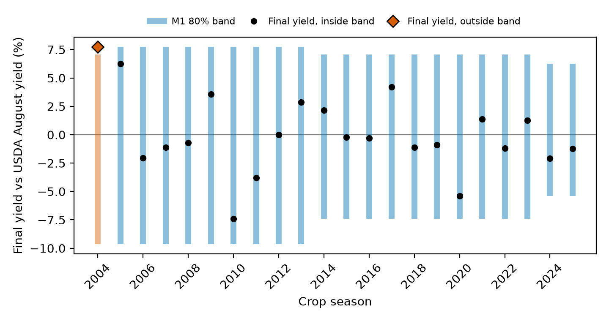

# How wide is USDA's August corn number?

Every August, the USDA's WASDE and Crop Production reports release the first survey-based US corn yield estimate, prompting grains desks to rapidly rebuild their balance sheets. This initial point estimate provides a direction, but to inform positioning, desks need to understand how far the January final can land from it. To assess this, I test whether a band built from the USDA's past August misses could maintain its stated coverage over 22 seasons.

The results show that an 80% band, scored over 22 seasons, covered 21 of them, more than its nominal coverage. The pre-registered verdict is "too wide", and about 4 points of the excess are expected from the estimator itself.

## Rebuilding what was known on release morning

Backtests that use today's revised numbers carry look-ahead bias, and it flatters their results. Every value is rebuilt from public USDA releases (WASDE, Crop Production, Crop Progress) with its release timestamp. Each row of data is timestamped, and a guard is in place to prevent the use of any value released after the forecast origin. Apart from the origin's own WASDE and the Crop Production report released with it, any series released on the origin date is treated as if it were released the next day, and leakage tests are run before every scored run.

Corrections are handled as separate records. Releases that survive only as corrected copies are flagged and used as archived, and re-posted files are logged. A sensitivity run drops the 2 affected evaluation origins and keeps their training errors; the August band still covers 21 of 22. Of the 24 of 215 origins that fall on a Crop Progress release day, none uses that day's report. The rules for the backtest were established beforehand, including the acceptance rule, wording, sample, and 33 exploratory tests with Holm adjustment.

One disclosure: replicating the Good–Irwin RMSE table was an earlier look at the USDA's August point against finals, so the RMSE comparison is not blind to that look. The replication gate reproduced NASS's printed August 2015 production RMSE (4.34 against 4.3) and missed August 2025 (3.69 against 3.8). The likely cause is that NASS's printed finals include later revisions: Quick Stats latest finals give 3.77. Every model tried is counted in `out/eval/models_tried.csv`: a trend baseline (B0), USDA's printed production band (B1), a carry-forward diagnostic (B2), the plain band (M1), revision momentum (M2), crop condition (M3) and the production band; a weather model (M4) was dropped before scoring. Timestamps and frozen rules enforce the recorded availability rules, though where only a corrected copy survives, the release-morning content cannot always be verified. They do not settle the quality of the score.

## What the score says

The USDA's August yield forecast is accompanied by our own 80% band, constructed from past percent misses. This band has covered 21 of 22 seasons, resulting in a 95.5% coverage rate, with a 90% Clopper-Pearson interval of 80.2% to 99.8%. As pre-registered, this is "too wide". The estimator is conservative by construction: under exchangeable errors, averaged over these seasons, it is expected to cover 84.2%, so about 4 points of the 15-point excess are expected from the estimator itself. The rest cannot be told apart from chance: the interval contains 84.2%, and one more miss would turn the verdict to "not distinguishable".

Exploratory analysis at other horizons, from May to November, shows coverage rates ranging from 77.3% to 95.5%, mostly not distinguishable from the nominal 80% rate at this sample size. The September band is also "too wide" (exploratory), with the same estimator excess. M3 and M1 are not distinguishable at August with 22 seasons: adding crop condition did not improve mean pinball loss over five quantiles (one-sided p = 0.888). That does not make the bands equivalent; the M3 band is narrower and covered only 15 of 22. Revision momentum (M2) is not distinguishable from M1 either (exploratory, one-sided p = 0.784).

A family of 33 exploratory tests was conducted, with none yielding a p-value below 0.05 after applying the Holm correction. The smallest raw p-value, 0.009, belongs to the trend baseline against M1 at November (two-sided, 17 seasons, M1 with the lower loss); it became 0.295 after correction.

## From yield band to stocks-to-use

Our 80% band around USDA's August 2025 print of 188.8 bu/ac ran from 178.6 to 200.6 bu/ac. The final yield in January came in at 186.5 bu/ac, which is inside our band. For production, we estimated a range of 15,592 to 17,893 Mbu, while the USDA estimated 16,742 Mbu. The January final production was 17,021 Mbu, also within our band.

The production quantiles go through USDA's August balance sheet with beginning stocks, imports and total use held fixed. Our production band is then used to estimate stocks-to-use ratios. Carry-in revisions sit beside it: since July, USDA revised beginning stocks by −35 Mbu, against +1,037 Mbu on production, and in 2019 the August-to-November carry-in revision was as large as the production one. The USDA's August balance sheet shows a stocks-to-use ratio of 13.3%, while our own estimates suggest a wider range, with the 10th percentile at 6.1%.

The relationship between stocks-to-use and price exhibits convexity, as described by Wright in 2011. This means that prices tend to rise more sharply as stocks approach a floor. So a downside stocks-to-use tail would move price more than an equally sized upside, although this fixed-use step estimates no price response. Our approach focuses on the yield tail and its implications for stocks-to-use. The August 2025 stocks-to-use quantiles show a median of 13.4% and a 90th percentile of 20.5%. These quantiles are conditional on USDA's use projections and are not scored.

## Where the band breaks

Descriptively, in the pre-named stress years, the band fails in drought springs and on late-season surprises. In 2012, a drought year, the January final fell beyond the 50% and 80% bands for May, June, and July origins, while August origins were covered. Late in the season the band covers less, though not distinguishably from nominal (exploratory): at November the 80% band covers 17 of 22 seasons (77.3%) and the 50% band 8 of 22 (36.4%). In 2020 the final fell beyond the 80% band for October and November origins.

The sample consists of 22 seasons, with each season worth about 4.5 coverage points. The supported verdict is "too wide": the August band covers 95.5% of seasons against a nominal 80%. About 4 points of this excess are expected from the estimator itself. More seasons would be required to support finer claims.

In 2019, a year with late planting, the final fell within the 80% band for all origins from May to November. On the records side, the v2 sensitivity run is null by construction, because the re-posted files carry identical values, and NASS primaries whose update alerts concern other crops stay unflagged. No traded edge is claimed.

## Beyond US corn

The same M1 calculation, with Russia-specific parsing and truth selection, has been applied to Russian wheat production data from the USDA's World Agricultural Supply and Demand Estimates (WASDE) table. The focus is on production, not yield. The question at hand is how well the initial August print by the USDA matches the eventual settled figure, which is considered the truth source. The object of measurement is the USDA's revisions, not the actual harvest or crop tracking.

The results show that the 80% band, derived from our code, covered 18 out of 18 seasons from 2006 to 2023. The Clopper-Pearson interval for this coverage is between 84.7% and 100%. The verdict on the band is "too wide". Averaged over the 18 seasons, the estimator alone expects 84.4% coverage, so about 4 points of the excess are expected from it.

This analysis is exploratory and outside the standard test family. The 18 seasons follow from two rules: the settled figure is the last WASDE that still prints the marketing year, in April almost three years after harvest, and each band needs nine prior errors. That last print is an operational definition, not a verified final. The settled figure for 2022/23 comes from a corrected-only file (April 2025). The same store, rulebook and coverage score apply to other origins with dated vintages, such as EU rapeseed via MARS or Brazil safrinha via CONAB, given sufficient seasons. The Russia line shows the harness runs on a second series; it makes no claim about effectiveness.
